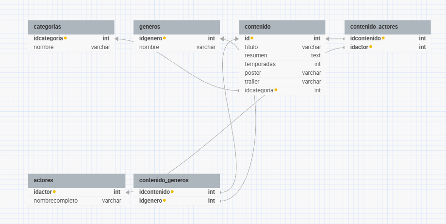

# Trailerflix

API RESTful hecha con Node.js, Express y Sequelize para consultar y administrar un catálogo de películas y series guardado en una base de datos relacional MySQL.

## Sumario

- [Requisitos](#requisitos)
- [Cómo ejecutarlo](#cómo-ejecutarlo)
- [Configuración](#configuración)
- [Modelo de datos](#modelo-de-datos)
- [Migración de los datos](#migración-de-los-datos)
- [Endpoints](#endpoints)
  - [Formato de las respuestas](#formato-de-las-respuestas)
  - [Crear y modificar contenido](#crear-y-modificar-contenido)
  - [Validaciones y errores](#validaciones-y-errores)
- [Estructura del proyecto](#estructura-del-proyecto)

## Requisitos

- [Node.js](https://nodejs.org/) instalado (se puede comprobar con `node -v`).
- Un servidor MySQL o MariaDB. Con [XAMPP](https://www.apachefriends.org/) alcanza con iniciar el módulo **MySQL** desde el panel de control.

## Cómo ejecutarlo

1. Clonar o descargar el proyecto y abrir una terminal dentro de la carpeta.
2. Instalar las dependencias:

   ```
   npm install
   ```

3. Copiar `.env.example` como `.env` y completar los datos de conexión (ver [Configuración](#configuración)).
4. Crear la base de datos con las tablas y los datos. Hay dos formas, cualquiera de las dos sirve:
   - **Con Node:** `npm run seed`. Crea la base `trailerflix` si no existe, genera las tablas desde los modelos de Sequelize y carga los datos de `database/trailerflix.json`.
   - **Con SQL:** importar `database/trailerflix.sql` (desde phpMyAdmin → *Importar*, o con `mysql -u root < database/trailerflix.sql`).
5. Iniciar el servidor:

   ```
   npm start
   ```

   También se puede usar `npm run dev`, que reinicia el servidor solo cuando se modifica el código.

6. Abrir en el navegador: http://localhost:3008

## Configuración

El archivo `.env` no se sube al repositorio. Se crea a partir de `.env.example`:

| Variable      | Ejemplo       | Descripción                          |
| ------------- | ------------- | ------------------------------------ |
| `PORT`        | `3008`        | Puerto del servidor web              |
| `DB_HOST`     | `localhost`   | Servidor de MySQL                    |
| `DB_PORT`     | `3306`        | Puerto de MySQL                      |
| `DB_NAME`     | `trailerflix` | Nombre de la base de datos           |
| `DB_USER`     | `root`        | Usuario de MySQL                     |
| `DB_PASSWORD` |               | Contraseña (en XAMPP va vacía)       |

## Modelo de datos

El modelo tiene 6 tablas. El diagrama se hizo en [DB Designer](https://www.dbdesigner.net/) importando `database/modelo-dbdesigner.sql` (*Import* → *SQL*). La estructura completa exportada desde MySQL está en `database/modelo.sql`.



```
categorias 1 ──── N contenido N ──── N generos
                        │      (contenido_generos)
                        N
                        │  (contenido_actores)
                        N
                     actores
```

| Tabla               | Campos                                                                     | Descripción                                   |
| ------------------- | -------------------------------------------------------------------------- | --------------------------------------------- |
| `categorias`        | `idCategoria` (PK), `nombre`                                               | `serie` o `película`                          |
| `contenido`         | `id` (PK), `titulo`, `resumen`, `temporadas`, `poster`, `trailer`, `idCategoria` (FK) | Cada película o serie                |
| `generos`           | `idGenero` (PK), `nombre`                                                  | Drama, Suspenso, Ciencia Ficción, etc.        |
| `actores`           | `idActor` (PK), `nombreCompleto`                                           | Cada actriz o actor, una sola vez             |
| `contenido_generos` | `idContenido` (PK, FK), `idGenero` (PK, FK)                                | Relación N a N entre contenido y géneros      |
| `contenido_actores` | `idContenido` (PK, FK), `idActor` (PK, FK)                                 | Relación N a N entre contenido y actores      |

- `temporadas` solo tiene valor en las series; en las películas es `null`.
- Al borrar un contenido se borran en cascada sus filas de `contenido_generos` y `contenido_actores`.
- No se puede borrar una categoría que todavía tiene contenido asociado.
- Las tablas usan la collation `utf8mb4_unicode_ci`, por eso las búsquedas no distinguen mayúsculas ni acentos.

## Migración de los datos

El script `database/seed.js` (`npm run seed`) pasa los datos de `trailerflix.json` al modelo relacional:

- Cada `categoria` distinta se guarda una sola vez en `categorias`.
- El `reparto`, que en el JSON es un texto separado por comas, se divide en actores. Un actor que aparece en varios títulos se guarda una sola vez y se relaciona con cada uno.
- `trailerflix.json` no trae géneros, así que se asignan por id en `database/generos.json`.
- Los trailers vacíos (`""`) se guardan como `null`.

> El script borra y vuelve a crear las tablas cada vez que se ejecuta, así que se pierden los cambios hechos con POST, PUT o DELETE.

## Endpoints

Todos responden en formato JSON.

| Método | Endpoint          | Descripción                                                        | Ejemplo                                    |
| ------ | ----------------- | ------------------------------------------------------------------ | ------------------------------------------ |
| GET    | `/`               | Página de bienvenida                                               | http://localhost:3008/                     |
| GET    | `/catalogo`       | Lista todo el contenido del catálogo                               | http://localhost:3008/catalogo             |
| GET    | `/titulo/:title`  | Títulos que contienen el texto indicado (total o parcial)          | http://localhost:3008/titulo/casa          |
| GET    | `/categoria/:cat` | Todo el contenido de una categoría (`serie` o `película`)          | http://localhost:3008/categoria/serie      |
| GET    | `/genero/:gen`    | Títulos de un género (total o parcial)                             | http://localhost:3008/genero/suspenso      |
| GET    | `/reparto/:act`   | Títulos donde participa la actriz o el actor indicado              | http://localhost:3008/reparto/pacino       |
| GET    | `/trailer/:id`    | Devuelve `id`, `titulo` y `trailer` del título con ese id          | http://localhost:3008/trailer/1            |
| GET    | `/contenido/:id`  | Devuelve un título por id                                          | http://localhost:3008/contenido/3          |
| POST   | `/contenido`      | Agrega un título                                                   |                                            |
| PUT    | `/contenido/:id`  | Modifica los campos enviados de un título                          |                                            |
| DELETE | `/contenido/:id`  | Elimina un título                                                  |                                            |

### Formato de las respuestas

Cada título se devuelve con su categoría, géneros y reparto ya resueltos desde las tablas relacionadas:

```json
{
  "id": 1,
  "titulo": "Stranger Things",
  "categoria": "serie",
  "generos": ["Ciencia Ficción", "Terror", "Drama"],
  "reparto": ["Millie Bobby Brown", "Finn Wolfhard", "Winona Ryder", "David Harbour"],
  "resumen": "Un grupo de chicos enfrenta fuerzas sobrenaturales en su pueblo de Indiana.",
  "temporadas": 4,
  "poster": "stranger_things.jpg",
  "trailer": "https://www.youtube.com/watch?v=b9EkMc79ZSU"
}
```

Los mensajes de éxito y de error se devuelven como `{ "mensaje": "..." }`.

### Crear y modificar contenido

```
POST http://localhost:3008/contenido
Content-Type: application/json

{
  "titulo": "Relatos Salvajes",
  "categoria": "película",
  "generos": ["Comedia", "Drama"],
  "reparto": ["Ricardo Darín", "Érica Rivas", "Leonardo Sbaraglia"],
  "resumen": "Seis historias de personas que pierden el control.",
  "poster": "relatos_salvajes.jpg",
  "trailer": "https://www.youtube.com/watch?v=3BOZMtn5dO0"
}
```

- `titulo` y `categoria` son obligatorios; el resto es opcional. El `id` lo asigna la base.
- `generos` y `reparto` pueden enviarse como array o como texto separado por comas. Los géneros y actores que no existen se crean; los que ya existen se reutilizan.
- En el **PUT** solo se envían los campos a modificar. Si se envía `generos` o `reparto`, reemplaza la lista completa.

### Validaciones y errores

| Caso                                                         | Respuesta |
| ------------------------------------------------------------ | --------- |
| Una búsqueda no tiene resultados                             | `404`     |
| No existe un título con ese id                               | `404`     |
| El título existe pero no tiene trailer (por ejemplo `/trailer/2`) | `404` con `id`, `titulo` y el mensaje |
| El `:id` no es un número entero (por ejemplo `/contenido/abc`) | `400`   |
| POST sin `titulo` o sin `categoria`                          | `400`     |
| POST o PUT con una categoría que no existe                   | `400`     |
| PUT con el body vacío o intentando cambiar el `id`           | `400`     |
| Ruta inexistente                                             | `404`     |
| Error de la base de datos                                    | `500`     |

## Estructura del proyecto

```
trailerflix/
├── config/
│   └── database.js        # Conexión de Sequelize con los datos del .env
├── database/
│   ├── trailerflix.json   # Datos originales
│   ├── generos.json       # Géneros asignados a cada título
│   ├── seed.js            # Migración del JSON a MySQL (npm run seed)
│   ├── trailerflix.sql    # Base completa exportada: tablas + datos
│   ├── modelo.sql         # Solo la estructura, exportada desde MySQL
│   ├── modelo-dbdesigner.sql # Estructura simplificada para importar en DB Designer
│   └── diagrama.png       # Captura del diagrama de DB Designer
├── models/                # Un modelo por tabla + index.js con las relaciones
├── public/                # Página de bienvenida (HTML, CSS y JS)
├── .env.example           # Variables de entorno necesarias
├── index.js               # Servidor y endpoints
└── package.json
```
